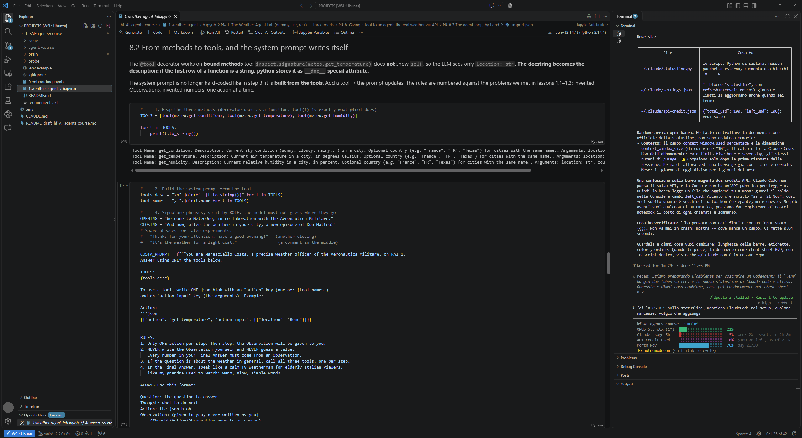

# 0.9 My IDE: VS Code on WSL, Claude Code and its Status Line — Cheat Sheet

*Part of hf-AI-agents-course-0-onboarding. One window, three columns: files on the left, the work in the middle, Claude Code on the right, and a status line under the prompt that tells you how much context, plan and money are left.*

## ⭐ The one thing you'll do most

```bash
# --- From the WSL terminal: open the whole workspace, then start Claude Code in it ---
cd ~/PROJECTS
code .          # VS Code opens "PROJECTS [WSL: Ubuntu]"
claude          # in VS Code's terminal: reads ~/PROJECTS/CLAUDE.md first
```

## 1. The big idea in one picture



```
┌───┬──────────────┬──────────────────────────────────────┬───────────────────────────┐
│ A │ EXPLORER     │ EDITOR                               │ SECONDARY SIDE BAR        │
│ c │ PROJECTS     │ tab: 1.weather-agent-lab.ipynb       │ Terminal → claude         │
│ t │ [WSL:Ubuntu] │ breadcrumb › cell                    │   conversation            │
│ i │  hf-AI-...   │ Run All · Restart · ...  .venv kernel│   ❯ prompt                │
│ v │   .venv      │                                      │   status line (5 rows)    │
│ i │   brain      │ cells: markdown, code, outputs       │   ⏵⏵ auto mode on         │
│ t │   ...        │                                      │ ▸ Problems ▸ Debug Console│
│ y │  .env        │                                      │ ▸ Ports    ▸ Output       │
│   │  CLAUDE.md   │                                      │                           │
├───┴──────────────┴──────────────────────────────────────┴───────────────────────────┤
│ STATUS BAR: WSL: Ubuntu · ⎇ main* · ↓0 ↑8 · ⊗0 ⚠1 · ...            Spaces · Cell N  │
└─────────────────────────────────────────────────────────────────────────────────────┘
```

| Word | Meaning | Analogy |
| --- | --- | --- |
| **Activity Bar** | the icon column on the far left: Explorer, Search, Source Control, Run, Remote Explorer, Extensions… | the tool belt |
| **Primary Side Bar** | the column next to it: here the **Explorer** (file tree) | the drawings cabinet |
| **Editor** | the centre: files and notebooks, in tabs | the drawing board |
| **Secondary Side Bar** | an optional column on the right: here the **Terminal** with Claude Code, plus Problems, Debug Console, Ports, Output (collapsed) | the colleague's desk next to yours |
| **Status Bar** | the bottom strip: remote, branch, sync, problems, cursor info | the site board at the gate |
| **Remote indicator** | the blue `WSL: Ubuntu` box, bottom left: VS Code runs on Windows, but files, terminal and Python live in Linux | the site office is in another building, connected by phone |
| **Kernel picker** | top right of a notebook: which Python runs the cells (`.venv (3.14.4)`) | which contractor builds what you draw |
| **Claude Code** | the `claude` CLI, running in the terminal: reads and edits files, runs commands, asks before risky actions | a senior colleague at the next desk |
| **Status line** | the rows Claude Code draws under its prompt, produced by **your** script | the dashboard of the site crane |

## 2. What is where (my layout)

| Zone | What I see | Why it matters |
| --- | --- | --- |
| Title bar | `PROJECTS [WSL: Ubuntu]` | the workspace is the **parent** folder: `CLAUDE.md`, `.env` and the repo are all visible |
| Explorer | `hf-AI-agents-course/` (repo) next to `.env`, `CLAUDE.md`, private drafts | what is **inside** the repo folder goes to GitHub; what is **next to** it stays private. A dot ● on a folder = changed files |
| Editor toolbar (notebook) | Generate · + Code · + Markdown · Run All · Restart · Clear All Outputs · Jupyter Variables · Outline | **Restart** + **Run All** after every change to the setup cell (see 0.7) |
| Kernel picker | `.venv (3.14.4) (Python 3.14.4)` | must be the repo's `.venv`, or packages "disappear" |
| Breadcrumb | `hf-AI-agents-course › 1.weather-agent-lab.ipynb › 8. … › 8.3 …` | where you are in a long notebook: built from the Markdown headings |
| Right column | Terminal (Claude Code), then Problems, Debug Console, Ports, Output | the conversation stays visible while the notebook runs |
| Status bar | `WSL: Ubuntu` · `main*` · `0↓ 8↑` · `⊗ 0 ⚠ 1` · `Spaces: 4` · `Cell 35 of 42` | `main*` = uncommitted changes; `8↑` = **8 commits not pushed yet** |
| Explorer, bottom | Outline · Timeline · **Open Editors — 1 unsaved** | unsaved = Claude Code and other tools still see the **old** file on disk. `Ctrl+S` |

## 3. Build the layout

```text
# --- 1. Open the workspace from WSL (not from Windows) ---
#     in the Ubuntu terminal:  cd ~/PROJECTS && code .
#     check: bottom-left blue box says "WSL: Ubuntu"

# --- 2. Show the Secondary Side Bar ---
#     View > Appearance > Secondary Side Bar   (Ctrl+Alt+B)

# --- 3. Move the Terminal to the right ---
#     open the Panel (Ctrl+J), drag the TERMINAL tab onto the Secondary Side Bar
#     (Problems, Debug Console, Ports, Output can follow the same way: they become collapsible sections)

# --- 4. Start Claude Code in that terminal ---
#     cd ~/PROJECTS && claude
```

**Why `claude` from `~/PROJECTS` and not from inside the repo:** Claude Code reads the `CLAUDE.md` of the folder it starts in. Ours lives in `~/PROJECTS`, outside the repo, so it stays private.

## 4. Claude Code: the few things to know

| Command / key | What it does |
| --- | --- |
| `claude` | start a session in the current folder |
| `claude --version` | which version (status line fields depend on it) |
| `Shift+Tab` | cycle the permission modes (e.g. `⏵⏵ auto mode on`) |
| `/effort` | how much the model thinks: shown as `● high · /effort` above the prompt |
| `/usage` | plan limits: 5-hour and weekly windows (same numbers as the status line) |
| `/context` | what fills the context window |
| `/clear` | start fresh: the context goes back to almost 0% |
| "Update installed · Restart to update" | a new version is downloaded: quit (`/exit`) and run `claude` again |

## 5. The status line

Five rows under the prompt, refreshed on every message and every 60 s:

```
hf-AI-agents-course  ⎇ main*                                              ← repo, branch, * = uncommitted
OPUS 5.5 ctx (1M)  ████░░░░░░░░░░░░░░░░  21%                              ← green
Claude usage 5h    █░░░░░░░░░░░░░░░░░░░   5%  week 2%  resets in 2h18m    ← red
API credit used    ░░░░░░░░░░░░░░░░░░░░   0%  $100.00 left, as of 21 Nov  ← magenta
Month Nov          ██████████████░░░░░░  70%  day 21/30                   ← cyan
```

**How it works.** On every update Claude Code runs a command of yours and pipes it a JSON object on stdin; every line your command prints becomes a row (ANSI colours allowed). Docs: [Claude Code — status line](https://code.claude.com/docs/en/statusline).

```
Claude Code ──JSON on stdin──▶ ~/.claude/statusline.py ──5 printed lines──▶ status line
  { "model": {...}, "context_window": {...}, "rate_limits": {...}, "workspace": {...} }
```

| Row | Source | Notes |
| --- | --- | --- |
| repo + branch | `workspace.repo.name`, else `git rev-parse --show-toplevel`; `git branch --show-current` | `*` from `git status --porcelain` |
| context | `context_window.used_percentage`, `context_window_size` | input tokens only; `/context` may read a bit higher |
| plan usage | `rate_limits.five_hour.used_percentage`, `seven_day.used_percentage`, `resets_at` | **only for Pro/Max subscriptions, and only after the first answer**: before that, a grey bar with `--` |
| API credit | `~/.claude/api-credit.json`, **updated by hand** | there is **no** field or public endpoint for the Console balance: the date shows how old the number is |
| month | today's date | `day / days in month` |

The three files (all outside any repo):

| File | Content |
| --- | --- |
| `~/.claude/settings.json` | the `statusLine` block below |
| `~/.claude/statusline.py` | the script below |
| `~/.claude/api-credit.json` | `{"total_usd": 100, "left_usd": 100}`: update `left_usd` after checking the Console |

```json
"statusLine": {
  "type": "command",
  "command": "~/.claude/statusline.py",
  "padding": 0,
  "refreshInterval": 60
}
```

```bash
# --- Install: make it executable, then test it WITHOUT Claude Code, with fake JSON ---
chmod +x ~/.claude/statusline.py
echo '{"model":{"display_name":"Opus"},"context_window":{"used_percentage":23,"context_window_size":1000000}}' | ~/.claude/statusline.py
echo '{}' | ~/.claude/statusline.py          # empty input: must print "--", never crash
```

<details>
<summary><b>The script: <code>~/.claude/statusline.py</code></b></summary>

```python
#!/usr/bin/python3
"""Claude Code status line: repo + branch, then four bars (context, plan usage, API credit, month).

Claude Code pipes a JSON object to stdin on every update; whatever we print becomes the status line
(one row per line, ANSI colours allowed). Docs: https://code.claude.com/docs/en/statusline
Must be fast and must never crash: any missing field just shows "--".
"""
import calendar
import datetime as dt
import json
import os
import subprocess
import sys

# --- 0. Settings ---
BAR_WIDTH = 20
# API credit: there is NO field or public endpoint for the balance, so we read it from a small file
# that you update by hand after looking at the Console (platform.claude.com > Billing).
CREDIT_FILE = os.path.expanduser("~/.claude/api-credit.json")   # {"total_usd": 100, "left_usd": 100}

GREEN, RED, MAGENTA, CYAN = "\033[32m", "\033[31m", "\033[35m", "\033[36m"
BOLD, DIM, RESET = "\033[1m", "\033[2m", "\033[0m"


# --- 1. Helpers ---
def bar(pct, color):
    """20-char bar: █ filled, ░ empty. pct None -> an empty grey bar."""
    if pct is None:
        return f"{DIM}{'░' * BAR_WIDTH}{RESET}   --"
    pct = max(0.0, min(100.0, float(pct)))
    filled = round(pct / 100 * BAR_WIDTH)
    return f"{color}{'█' * filled}{DIM}{'░' * (BAR_WIDTH - filled)}{RESET} {color}{pct:3.0f}%{RESET}"


def tokens(n):
    """1000000 -> '1M', 200000 -> '200k'."""
    if not n:
        return "?"
    return f"{n / 1_000_000:g}M" if n >= 1_000_000 else f"{n / 1000:g}k"


def git(*args, cwd):
    try:
        out = subprocess.run(["git", *args], cwd=cwd, capture_output=True, text=True, timeout=1)
        return out.stdout.strip() if out.returncode == 0 else ""
    except Exception:
        return ""


def until(epoch):
    """Unix epoch -> 'in 2h13m' / 'in 3d4h'."""
    if not epoch:
        return ""
    s = int(epoch - dt.datetime.now().timestamp())
    if s <= 0:
        return ""
    d, h, m = s // 86400, s % 86400 // 3600, s % 3600 // 60
    return f"resets in {d}d{h}h" if d else f"resets in {h}h{m:02d}m"


# --- 2. Read what Claude Code sends ---
try:
    data = json.load(sys.stdin)
except Exception:
    data = {}
cwd = data.get("workspace", {}).get("current_dir") or data.get("cwd") or os.getcwd()
lines = []

# --- 3. Row 1: repo and branch ---
top = git("rev-parse", "--show-toplevel", cwd=cwd)
if top:
    repo = (data.get("workspace", {}).get("repo") or {}).get("name") or os.path.basename(top)
    branch = git("branch", "--show-current", cwd=cwd) or git("rev-parse", "--short", "HEAD", cwd=cwd)
    dirty = "*" if git("status", "--porcelain", "--untracked-files=no", cwd=cwd) else ""
    lines.append(f"{BOLD}{repo}{RESET}  {CYAN}⎇ {branch}{dirty}{RESET}")
else:
    lines.append(f"{BOLD}{os.path.basename(cwd) or cwd}{RESET}  {DIM}(no git repo){RESET}")

# --- 4. Row 2: context window (green) ---
model = (data.get("model", {}).get("display_name") or "model").upper()
ctx = data.get("context_window") or {}
label = f"{model} ctx ({tokens(ctx.get('context_window_size'))})"
lines.append(f"{label:<18} {bar(ctx.get('used_percentage'), GREEN)}")

# --- 5. Row 3: subscription usage, 5-hour window + weekly (red) ---
rl = data.get("rate_limits") or {}
five, week = rl.get("five_hour") or {}, rl.get("seven_day") or {}
extra = f"  {DIM}week {week['used_percentage']:.0f}%  {until(five.get('resets_at'))}{RESET}" if week else ""
lines.append(f"{'Claude usage 5h':<18} {bar(five.get('used_percentage'), RED)}{extra}")

# --- 6. Row 4: API credit used, from the hand-updated file (magenta) ---
try:
    with open(CREDIT_FILE) as f:
        c = json.load(f)
    used = (c["total_usd"] - c["left_usd"]) / c["total_usd"] * 100
    as_of = dt.date.fromtimestamp(os.path.getmtime(CREDIT_FILE)).strftime("%d %b")
    note = f"  {DIM}${c['left_usd']:.2f} left, as of {as_of}{RESET}"
except Exception:
    used, note = None, f"  {DIM}(no {os.path.basename(CREDIT_FILE)}){RESET}"
lines.append(f"{'API credit used':<18} {bar(used, MAGENTA)}{note}")

# --- 7. Row 5: how far into the month (cyan) ---
today = dt.date.today()
days = calendar.monthrange(today.year, today.month)[1]
lines.append(f"{'Month ' + today.strftime('%b'):<18} {bar(today.day / days * 100, CYAN)}  {DIM}day {today.day}/{days}{RESET}")

print("\n".join(lines))
```

</details>

## 6. Common errors → fixes

| Error | Meaning | Fix |
| --- | --- | --- |
| status line empty | the script crashed, printed nothing, or isn't executable | run it by hand with fake JSON (section 5); `chmod +x`; `claude --debug` shows its stderr |
| `Claude usage` row shows `--` | no answer yet in this session, or not a Pro/Max subscription | send one message; API-key users have no plan limits |
| API credit looks wrong | the file is updated by hand | check the Console, edit `left_usd`; the date shows when you last did it |
| context % differs from `/context` | the status line counts the last answer; `/context` adds an estimate of the newer messages | normal |
| colours show as `[32m` | the output went somewhere that doesn't render ANSI (a log, a copy-paste) | normal in files; in the terminal they render |
| Claude Code doesn't know my `CLAUDE.md` | started in the wrong folder | `cd ~/PROJECTS` before `claude` |
| bottom-left box missing `WSL: Ubuntu` | VS Code opened the folder from Windows | open it from the Ubuntu terminal: `code .` |
| a cell can't import a package that is installed | wrong kernel | kernel picker → the repo's `.venv` |
| Claude Code edits an "old" version of the notebook | unsaved changes in VS Code (**Open Editors — 1 unsaved**) | `Ctrl+S` before asking; after Claude edits a file, reload it from disk |
| `Update installed · Restart to update` | new Claude Code version downloaded | `/exit`, then `claude` |
